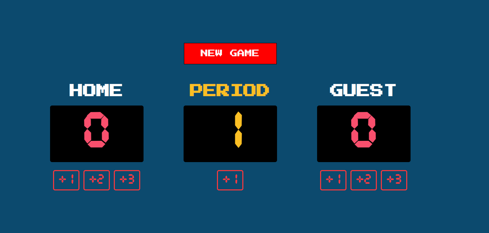

# 🏀 Basketball Scoreboard

A retro-style basketball scoreboard: add 1, 2 or 3 points to each team, track the period and start a new game in one click.

Solo project from the [Scrimba Fullstack Developer Path](https://scrimba.com/fullstack-path-c0fullstack) (*JavaScript Fundamentals* module), my first project built from scratch, based on a Figma design provided by Scrimba.

**🌐 Live demo:** [Scrimba Basketball App](https://scrimbasketballapp.netlify.app)



## ✨ Features

- **+1, +2, +3 buttons** for the HOME and GUEST teams
- **Period counter**: the game resets automatically after the 4th period
- **NEW GAME** button that resets both scores and the period
- Digital scoreboard look with a custom timer font and a retro pixel font

## 🛠️ Built with

- HTML5
- CSS3 (Flexbox, `@font-face`, Google Fonts: Press Start 2P)
- Vanilla JavaScript (no framework, no library)

## 🧠 What I practiced

- Building a full project from a Figma design, without step-by-step guidance
- Keeping the game state in variables and showing it with `textContent`
- Writing functions and calling them with `onclick`
- Resetting the state and the display together
- Using an `if` statement to end the game after the last period
- Loading a custom font with `@font-face`

## 🚀 Run it locally

```bash
git clone https://github.com/Hushhhy/simpleBasketballScoreboard.git
cd simpleBasketballScoreboard
```

Then open `index.html` in your browser. No installation needed.

## 📁 Project structure

```
simpleBasketballScoreboard/
├── index.html
├── style.css
├── script.js
└── assets
    ├── CursedTimerUlil-Aznm.ttf
    └── screenshot.png
```

## 🙏 Credits

- Project brief and design: [Scrimba](https://scrimba.com)
- Timer font: [Cursed Timer ULiL](https://www.fontspace.com/cursed-timer-ulil-font-f29411) by heaven castro, freeware (FontSpace)
- Built by [Alexis Carpentier](https://github.com/Hushhhy)